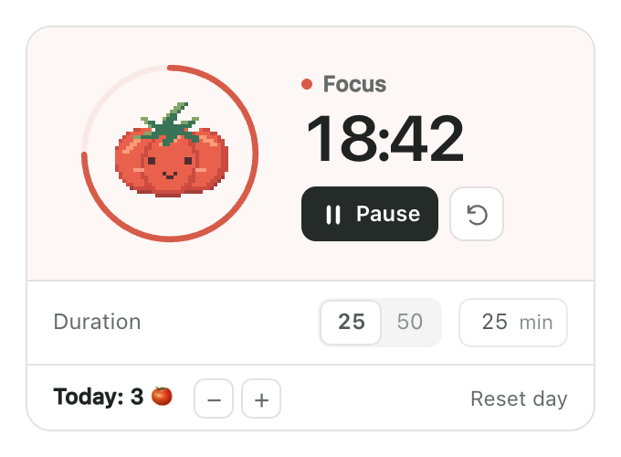
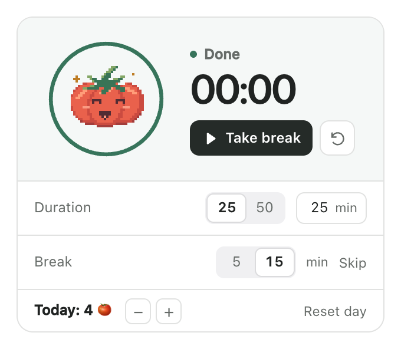
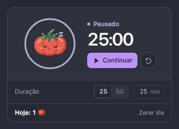
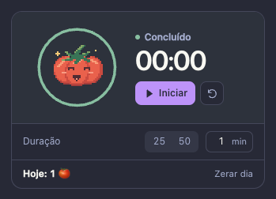

# Pomodoro 🍅 — um tomate de estimação para o Orca

Plugin do Orca com um timer Pomodoro que mora na barra de status e num painel animado na
barra lateral direita.

- **Barra de status:** `🍅 18:42 · 3` (tempo restante · pomodoros de hoje). Cor de destaque
  enquanto roda, neutra quando pausado/parado (`⏸` quando pausado), verde ao terminar
  (`🍅 Pronto! · 4`). Clique para abrir o painel.
- **Painel (v0.2, desenho A · Dueto):** um cartão compacto (~250 px de altura a 340 px de
  largura). À esquerda, o tomate **Costelão** em pixel art 32 × 32 (rosto A · Pontinho) dentro de
  um anel de progresso; à direita, o estado (Em foco / Pausado / Concluído / Pronto), a contagem
  regressiva e **Pausar/Iniciar/Continuar** com o botão de resetar. Abaixo, **Duração** com os
  atalhos 25 / 50 e um campo de minutos (1–180), e **Hoje: N 🍅** com **Zerar dia** (pede
  confirmação com um segundo clique). O tomate fica concentrado (piscando) enquanto roda, dorme com
  um "Z" quando pausado ou parado, e festeja com brilhos ao terminar. Segue o tema claro/escuro do
  Orca e mostra um quadro parado com `prefers-reduced-motion`.
- **Aviso:** ao fim de um pomodoro, notificação do sistema "Pomodoro concluído 🍅" com a contagem
  do dia. (Ainda não há timer de pausa.)

| Em foco | Pausado | Concluído | Escuro |
| --- | --- | --- | --- |
|  |  |  |  |

> Essas imagens são o painel real (`plugin/src/panel.html`) renderizado no Chromium com um `orca`
> simulado e as cores padrão do desenho; dentro do Orca as cores vêm do tema ativo. Para
> regenerar (na raiz do repositório, depois de `npm install`):
>
> ```sh
> npm install --prefix /tmp/pomodoro-preview playwright@1.63.0
> NODE_PATH=/tmp/pomodoro-preview/node_modules \
> CHROME_PATH='/Applications/Google Chrome.app/Contents/MacOS/Google Chrome' \
> node docs/screenshots/v0.2/capture.cjs
> ```

**Dentro do Orca** (`orca plugin shot`, tema escuro do Orca, 27/11/2026):

| Pronto | Em foco | Pausado | Concluído |
| --- | --- | --- | --- |
|  |  |  |  |

Barra de status:  ·
 ·


Rodadas de desenho: [layouts compactos](docs/design/v2/README.md) ·
[seis tomates de pixel](docs/design/v3-tomato/README.md) ·
[rostos do Costelão](docs/design/v4-costelao/README.md). As capturas do v0.1 continuam em
`docs/screenshots/preview-*.png`.

## Instalar e ativar

O plugin fica em `plugin/` (a raiz do repositório só tem docs e o TypeScript para checar
tipos). Carregue como pasta de desenvolvimento (chave `local.pomodoro`):

```sh
orca plugin dev load ~/playground/orca-pomodoro/plugin --json
```

Na primeira vez o Orca responde `approval_required` com a lista de acessos e um comando com
`--approve <fingerprint>`; confira e rode esse comando. Acessos pedidos:

- roda código próprio num processo Node (`trusted-worker`);
- `notifications:show` — notificação ao fim do pomodoro;
- `storage:own` — guarda o timer e a contagem diária;
- `settings:own` — lê a configuração `focusMinutes`.

Para desenvolver: `orca plugin dev watch plugin --check --shot plugin/.orca/shots --json`.

## Usar

- Clique no item `🍅` da barra de status, ou **Mod+Shift+P** (Cmd+Shift+P no macOS), para abrir o
  painel.
- Paleta de comandos: **Pomodoro: Iniciar/Pausar**, **Resetar timer**, **Zerar contagem do dia**,
  **Abrir Pomodoro**, **Foco 25 min**, **Foco 50 min**.
- Configurações → Pomodoro → **Minutos de foco** (`focusMinutes`, 1–180, padrão 25): duração
  usada quando o timer está parado.

## Como funciona

- O worker (`src/worker.ts`) é o dono do timer. O estado fica em `orca.storage` (chave
  `pomodoro`) como fatos de relógio — `endsAt` enquanto roda, `pausedRemainingMs` quando pausado —
  e nunca como contador de ticks. Por isso reiniciar o Orca ou recarregar o worker mantém o tempo
  certo; um pomodoro que acabou com o Orca fechado é contado uma vez (no dia em que terminou) e
  notificado uma vez quando o worker volta.
- A contagem é guardada por data local (`YYYY-MM-DD`), então vira sozinha à meia-noite.
- O worker atualiza a barra de status uma vez por segundo só enquanto roda, avisa os painéis
  abertos com `panels.post`, e o painel também escuta `storage.onDidChange`.
- Abrir o painel: o host não tem um método para isso, então o worker executa
  `orca plugin open <chave> --panel pomodoro` via `child_process` (CLI de `ORCA_CLI_COMMAND`, do
  bundle do app, ou `orca` no PATH), descobrindo a própria chave com `orca plugin list`.

## Desenvolvimento

```sh
npm install           # só o TypeScript, na raiz (fora da pasta do plugin)
cd plugin
npx tsc -p .
orca plugin test . --json
orca plugin validate . --json
orca plugin check . --json
```

Arquivos (em `plugin/`): `src/timer.ts` (lógica pura), `src/worker.ts`, `src/open-panel.ts`,
`src/panel.html` + `panel.css` + `panel-main.ts` (DOM) + `panel-view.ts` (lógica testável do
painel), `src/sprites.ts` (o Costelão, quadro a quadro, igual ao das rodadas de desenho), testes em
`src/*.test.ts`.
