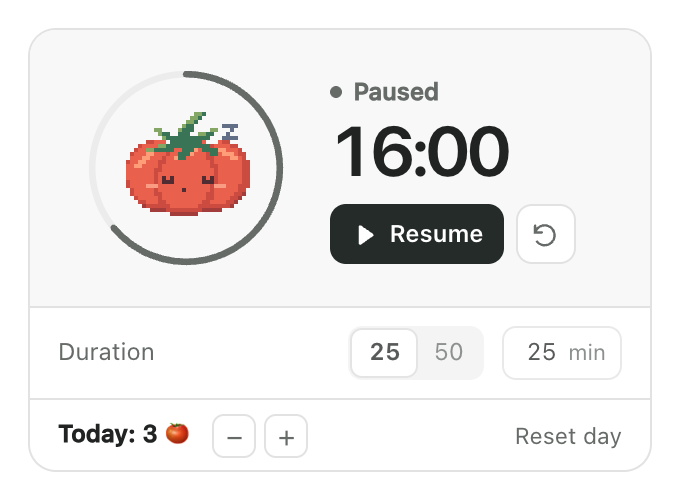
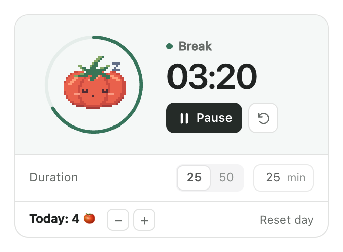
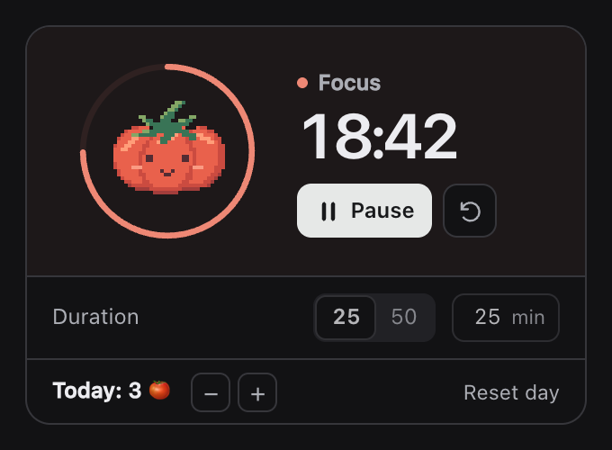
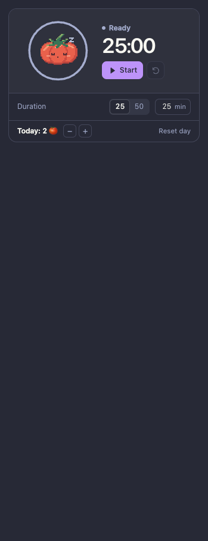
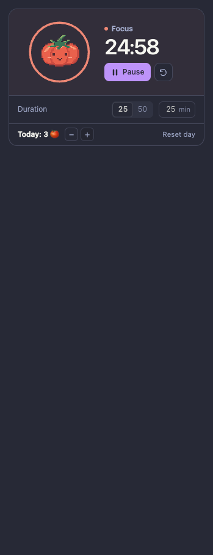
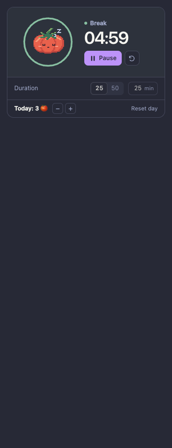
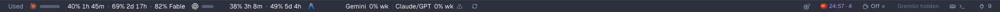
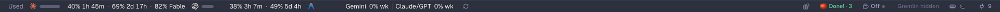
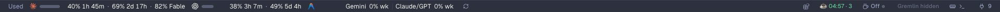

# Pomodoro 🍅 — a pet tomato for Orca

An Orca plugin with a Pomodoro timer that lives in the status bar and in an animated panel in the
right sidebar.

- **Status bar:** `🍅 18:42 · 3` (time left · pomodoros today). Accent color while running,
  neutral when paused or stopped (`⏸` when paused), green when done (`🍅 Done! · 4`). Click it to
  open the panel.
- **Panel (v0.2, design A · Dueto):** a compact card (~250 px tall at 340 px wide). On the left,
  the **Costelão** tomato in 32 × 32 pixel art (face A · Pontinho) inside a progress ring; on the
  right, the state (Focus / Paused / Done / Ready), the countdown, and **Pause/Start/Resume**
  next to the reset button. Below, **Duration** with 25 / 50 shortcuts and a minutes field
  (1–180), and **Today: N 🍅** with **−** and **+** buttons to correct the count by one (it
  never goes below zero) and **Reset day** (asks for a second click to confirm). The tomato
  looks focused (and blinks) while running, sleeps with a "Z" when paused or stopped, and
  celebrates with sparkles when done. It follows Orca's light/dark theme and shows a still frame
  under `prefers-reduced-motion`.
- **Breaks:** when a pomodoro ends, the panel already proposes the break: the main button becomes
  **Take break** and a **Break** row appears with **5 / 15 min** (5 is preselected; on the 4th
  pomodoro of the day, and every 4th after that, 15 is preselected). Pick 5 or 15 and click
  **Take break**, or click **Skip** to start another pomodoro right away. A break has a green
  ring, the tomato sleeps, the status bar shows `☕ 04:32 · 3`, and it does not count as a
  pomodoro. When it ends, **Start** goes back to a pomodoro of the length you had before.
- **Notifications:** when a pomodoro ends, a system notification "Pomodoro done 🍅" with the day's
  count and the suggested break; when a break ends, "Break over ☕".

| Focus | Paused | Done (break proposed) | Break | Dark |
| --- | --- | --- | --- | --- |
|  |  |  |  |  |

> These images are the real panel (`plugin/src/panel.html`) rendered in Chromium with a stand-in
> `orca` and the design's default colors; inside Orca the colors come from the active theme. To
> regenerate them (from the repository root, after `npm install`):
>
> ```sh
> npm install --prefix /tmp/pomodoro-preview playwright@1.63.0
> NODE_PATH=/tmp/pomodoro-preview/node_modules \
> CHROME_PATH='/Applications/Google Chrome.app/Contents/MacOS/Google Chrome' \
> node docs/screenshots/v0.2/capture.cjs
> ```

**Inside Orca** (`orca plugin shot`, Orca's dark theme):

| Ready | Focus | Paused | Done | Break |
| --- | --- | --- | --- | --- |
|  |  |  |  |  |

Status bar:  ·
 ·
 ·


Design rounds: [compact layouts](docs/design/v2/README.md) ·
[six pixel tomatoes](docs/design/v3-tomato/README.md) ·
[Costelão's faces](docs/design/v4-costelao/README.md).

## Install and enable

The plugin lives in `plugin/` (the repository root only has docs and the TypeScript compiler for
type checking). Load it as a development folder (key `local.pomodoro`):

```sh
orca plugin dev load ~/playground/orca-pomodoro/plugin --json
```

The first time, Orca answers `approval_required` with the list of accesses and a command with
`--approve <fingerprint>`; check the list and run that command. It will ask for:

- running its own code in a Node process (`trusted-worker`);
- `notifications:show` — the notification when a pomodoro ends;
- `storage:own` — keeps the timer and the daily count;
- `settings:own` — reads the `focusMinutes` setting.

Adding or renaming a command or shortcut in `orca-plugin.json` changes the approval, so the plugin
stops running until you approve it again.

To develop: `orca plugin dev watch plugin --check --shot plugin/.orca/shots --json`.

## Usage

- Click the `🍅` status bar item, or press **Mod+Shift+P** (Cmd+Shift+P on macOS), to open the
  panel.
- Command palette: **Pomodoro: Start/Pause**, **Reset timer**, **Reset day count**,
  **Open Pomodoro**, **Focus 25 min**, **Focus 50 min**, **Start break** (the suggested one).
- Settings → Pomodoro → **Focus minutes** (`focusMinutes`, 1–180, default 25): the length used
  when the timer is stopped.

## How it works

- The worker (`src/worker.ts`) owns the timer. Its state lives in `orca.storage` (key
  `pomodoro`) as wall-clock facts — `endsAt` while running, `pausedRemainingMs` while paused —
  never as a tick counter. So restarting Orca or reloading the worker keeps the right time; a
  pomodoro that ended while Orca was closed is counted once (on the day it ended) and notified
  once when the worker comes back.
- A timer is a `focus` or a `break`. A break never counts, and remembers the pomodoro length
  (`focusMs`) so the next pomodoro starts at the length you had before.
- Counts are stored by local date (`YYYY-MM-DD`), so they roll over by themselves at midnight.
- The worker updates the status bar once a second only while running, tells open panels with
  `panels.post`, and the panel also listens to `storage.onDidChange`.
- Opening the panel: the host has no method for it, so the worker runs
  `orca plugin open <key> --panel pomodoro` through `child_process` (the CLI from
  `ORCA_CLI_COMMAND`, from the app bundle, or `orca` on the PATH), finding its own key with
  `orca plugin list`.

## Development

```sh
npm install           # TypeScript only, at the root (outside the plugin folder)
cd plugin
npx tsc -p .
orca plugin test . --json
orca plugin validate . --json
orca plugin check . --json
```

Files (in `plugin/`): `src/timer.ts` (pure logic), `src/worker.ts`, `src/open-panel.ts`,
`src/panel.html` + `panel.css` + `panel-main.ts` (DOM) + `panel-view.ts` (the panel's testable
logic), `src/sprites.ts` (Costelão, frame by frame, the same as in the design rounds), tests in
`src/*.test.ts`.
