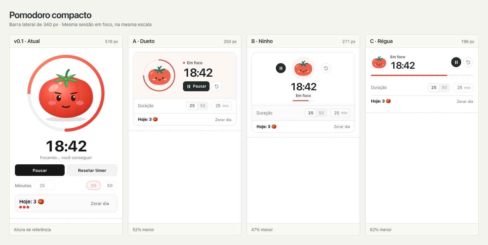

# Três versões compactas do Pomodoro



Cada coluna tem os mesmos 340 px da captura original. A linha pontilhada marca o fim do conteúdo, incluindo o espaçamento do painel. O v0.1 ocupa 516 px de altura.

| Protótipo interativo | Desenho | Altura | Redução |
| --- | --- | ---: | ---: |
| [A · Dueto](dueto.html) | Tomate dentro do anel, ao lado do relógio e do botão com texto. | 250 px | 52% |
| [B · Ninho](ninho.html) | Tomate central entre dois botões redondos, com o relógio logo abaixo. | 271 px | 47% |
| [C · Régua](regua.html) | Tomate, tempo e controles na mesma linha, com uma régua de progresso logo abaixo. | 196 px | 62% |

**Recomendação:** Régua. Libera 320 px de altura para o restante da barra lateral. O relógio continua fácil de ler e o tomate de cerca de 42 px ainda mostra quando está focado, dormindo ou comemorando.

| Variante | Em foco | Pausado | Concluído | Em foco no escuro |
| --- | --- | --- | --- | --- |
| Dueto | [Claro](dueto-running-light.png) | [Claro](dueto-paused-light.png) | [Claro](dueto-finished-light.png) | [Escuro](dueto-running-dark.png) |
| Ninho | [Claro](ninho-running-light.png) | [Claro](ninho-paused-light.png) | [Claro](ninho-finished-light.png) | [Escuro](ninho-running-dark.png) |
| Régua | [Claro](regua-running-light.png) | [Claro](regua-paused-light.png) | [Claro](regua-finished-light.png) | [Escuro](regua-running-dark.png) |

## Experimentar

Abra um dos três HTMLs diretamente no navegador. O protótipo simula a sessão e a contagem em memória. Recarregar restaura o exemplo. Para abrir um estado específico, acrescente, por exemplo, `?state=paused&theme=dark` ao endereço. Os estados disponíveis são `running`, `paused`, `finished` e `idle`. O tema acompanha o sistema e aceita `light` ou `dark` na URL.

## Reproduzir as capturas

O script usa Playwright com Chromium, escala de 1 pixel por pixel CSS e relógio congelado. As capturas individuais têm a altura do conteúdo. A montagem usa o PNG arquivado do v0.1 em escala natural.

Na raiz do repositório, usando o Chrome instalado no macOS:

```sh
npm install --prefix /tmp/pomodoro-preview playwright@1.63.0
NODE_PATH=/tmp/pomodoro-preview/node_modules \
CHROME_PATH='/Applications/Google Chrome.app/Contents/MacOS/Google Chrome' \
node docs/design/v2/capture.cjs
```
